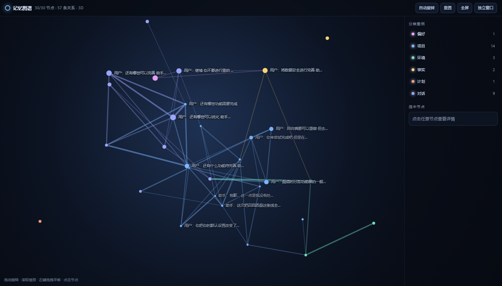
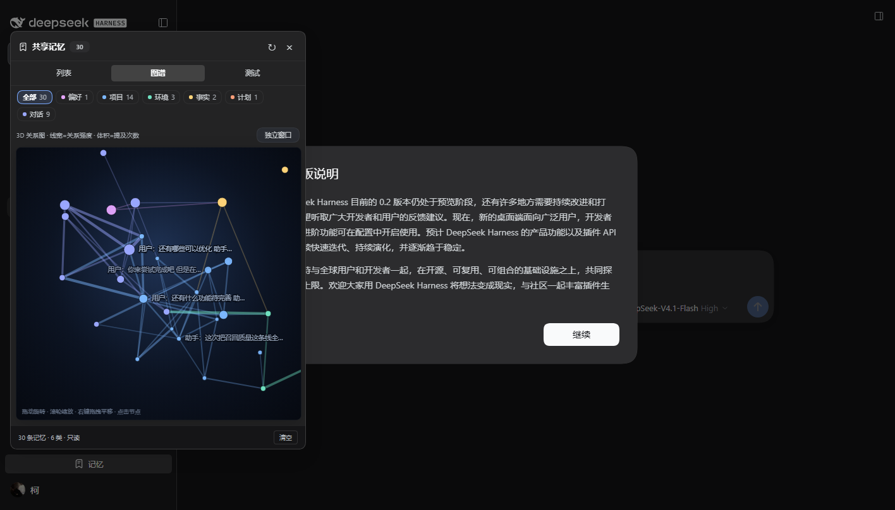
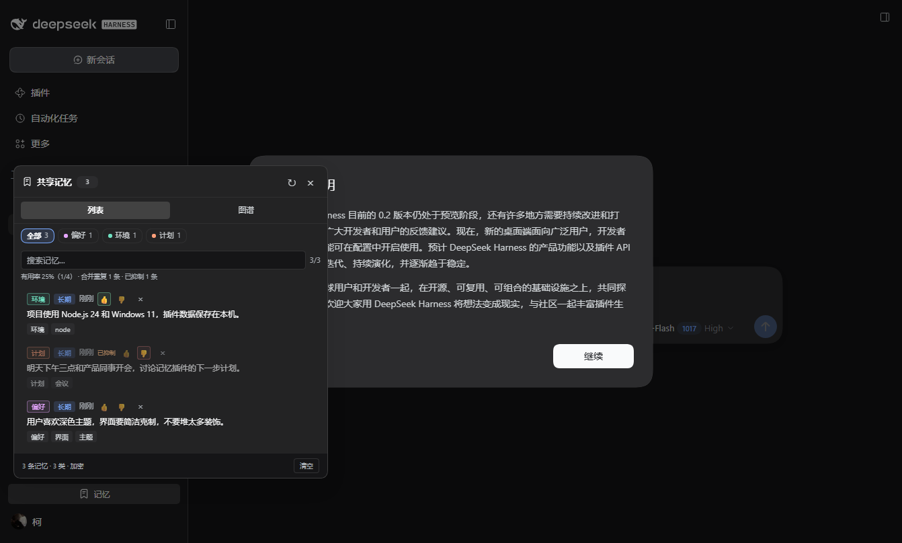
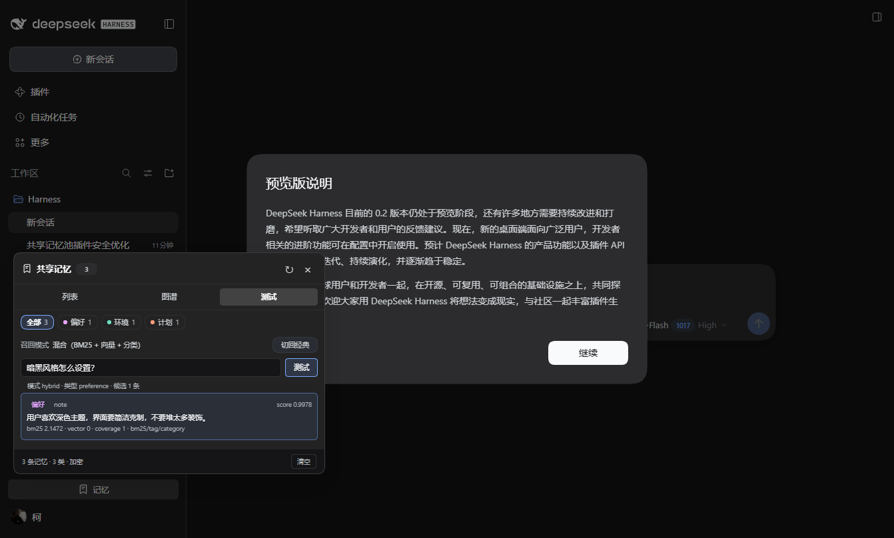
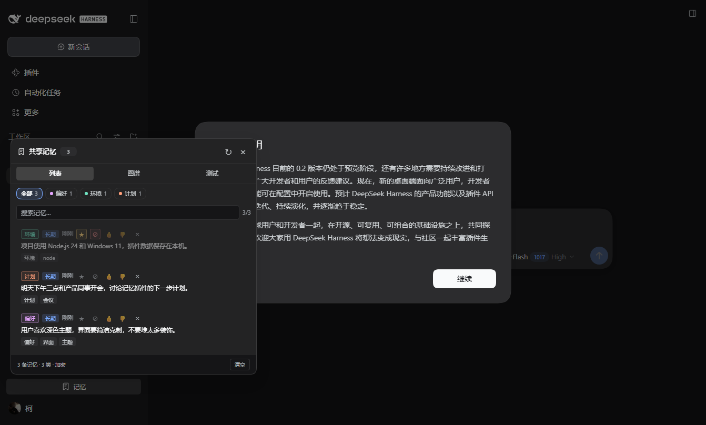

# dsh-memory

给本机所有 DeepSeek Harness 对话共用的一个持久记忆池。相关话题被提及时自动召回，侧边栏底部提供可视化面板；记忆的存储与召回都在本地完成。












## 特点

- **一个本机共享池**：所有会话、所有工作区共用 `$DSH_HOME/storages/dsh-memory/memories.json`。
- **零 token 自动压缩摘要**：用户真正输入的 prompt 和助手最终回复只在本地做结构化抽取式压缩后入库（单条 ≤420 字，回合合并后 ≤760 字），保留开头结论、要点列表和结尾结论，不再把列表内容整个丢掉；不保存完整对话，也不调用模型；插件注入的 runtime context、技能目录、时间快照、工具调用中间步骤不会被误存。
- **密钥/隐私过滤**：入库前自动遮蔽私钥、API key、GitHub token、JWT、Bearer、密码等敏感片段，并把代码块、长链接替换为占位符。
- **加密落盘**：记忆池用 AES-256-GCM 加密后写入 `memories.json` 快照，日常新增/删除/召回事件追加到 `memories.json.journal.jsonl`（每行一个独立加密事件），每 200 条或 512 KB 自动压实成新快照；密钥保存在同目录 `key.bin`（32 字节，仅当前用户可读）；旧版明文数据在首次加载时自动迁移为密文。
- **数据安全**：同一数据目录只允许一个写入者（`memories.json.lock`，写入者 PID + 实例标识，异常退出后可接管）；写入采用「加密快照 + 加密追加日志」，写文件执行 `fsync`，每 200 条事件或 512 KB 自动压实，崩溃留下的半行日志会被忽略；压实后即使日志截断失败，重放也会按快照 `revision`/`generation` 幂等跳过；启动时每 6 小时自动保留一份加密快照，迁移、清空、恢复前强制备份，备份保留最近 16 份；第二个进程自动进入只读模式，仍可查看和召回，但不会覆盖数据。面板「测试」页可立即备份、校验、导出/导入加密归档、恢复任意备份，恢复前会自动预检并备份当前数据。模型调用 `memory save/forget`、面板反馈/分类/删除/清空等显式写操作会等待落盘确认；写入失败时不会返回成功，事件保留在队列中按 5 秒起、最长 60 秒的退避自动重试，面板「数据安全」区显示最近一次写入错误。
- **克制的自动召回（默认经典模式）**：本地 BM25 风格关键词匹配 + 同义词概念扩展 + 本地特征哈希向量余弦 + 分类上下文加权；同义改写（如“暗色/深色”“会议/开会”）和轻微拼写差异（如 `kubernetis` / `kubernetes`）也能命中。只有相关度足够高时才注入；最多 2 条、总长不超过 760 字符，只在该轮第一步出现一次，且同一会话不会重复注入同一条记忆。
- **可选混合召回**：在面板「测试」页可一键切到混合模式，用 RRF 融合 BM25、向量、标签/分类三路排序，并加入置信度间隔、MMR 多样性和意图偏置。默认仍是经典模式，保持原有行为；切换后写入 `config.json`，可随时切回。
- **回合记忆与可解释召回**：助手回复在 15 分钟内会与同一会话的上一条用户消息合并成一条 `episode`，避免用户和助手各存一条；摘要保留「要点」列表与「结论」结构。「测试」页输入查询即可看到每条候选的 `score / bm25 / vector / coverage / reasons`，不调用模型、不注入对话。列表支持置顶 ★ 和屏蔽 ⊘，被屏蔽的记忆不再自动召回。
- **质量反馈与自动整理**：列表里每条记忆都可以点 👍 / 👎。反馈会调整重要度和召回排序；连续 3 次“没用”且没有“有用”反馈的记忆会停止自动召回，再点一次 👍 即可恢复。新记忆入库时会自动合并高度相似的近重复项（同类型、同分类、Jaccard ≥ 0.78），减少重复记录。
- **模型可主动维护**：`memory` 工具支持 `search` / `save` / `forget` / `feedback`，适合保存稳定的偏好、环境事实和长期项目约定。
- **自动分类 + 可纠正**：每条记忆按标签和本地关键词给所有分类打分，保留一个主分类、置信度、候选次分类和打分明细；低置信度进入「未分类」，不强行塞进某个桶。列表里的分类胶囊是下拉框，可以手动改成任意分类（手动结果优先，置信度记为 100%），不调用模型，也不额外消耗 token；列表和图谱都可按分类筛选。
- **3D 关系图谱**：侧边栏底部「记忆」按钮打开面板，含列表、图谱、测试三个页签。图谱是独立的 3D 画布：节点代表一条记忆/回合，边代表语义关系。边的粗细和亮度由关系强度决定；节点体积随召回次数、合并次数和置顶情况增大；布局按分类星团组织，支持旋转、平移、缩放、自动旋转、分类筛选、搜索高亮和详情。标签会做屏幕空间碰撞检测，拥挤时自动隐藏次要标签；分类图例在独立侧栏，不遮挡图面。
- **独立图谱窗口**：图谱右上角「独立窗口」可打开无侧栏的完整视图，窗口可自由拉伸；支持全屏、自动旋转和重置视角。图例、分类统计和选中详情都随窗口一起打开，不会和节点标签挤在侧边栏里。
- **纯本地**：不使用神经网络嵌入或嵌入 API，不联网，不上传任何内容。

## 安装

把仓库克隆到本机后，在仓库根目录运行：

```powershell
git clone https://github.com/Alive-Kenan/dsh-memory.git
cd dsh-memory
node scripts/install.mjs desktop
```

安装脚本会把插件复制为 `<DSH_HOME>/profiles/desktop/node_modules/dsh-memory` 真实目录，并把 `dsh-memory` 追加到该 profile 的 `dsh.profile.bundles`；完成后重启 DeepSeek Harness 即可。

> 注意：不要用 `link:` 或目录联接安装。DSH 的 ESM 拦截只对 profile 内的真实路径生效，符号链接会导致启动时报 `ERR_MODULE_NOT_FOUND: @deepseek-ai/dsh-llm`。

## 使用

- 侧边栏底部点击「记忆」打开面板。
- 顶部分类胶囊按 `偏好 / 项目 / 环境 / 事实 / 计划 / 人物 / 对话 / 未分类` 筛选；搜索框同时匹配正文、标签和分类名。
- 「列表」查看、搜索、删除记忆；每行左侧的分类胶囊是下拉框，可手动纠正自动分类（显示 `+N` 表示还有候选次分类，悬停可看置信度与来源）。每行右侧的 👍 / 👎 用来反馈召回质量，顶部会显示召回次数、有用率、合并重复数和抑制数。★ 置顶、⊘ 屏蔽该条记忆。列表分批加载（每批 120 条，最多 1000 条）。
- 「图谱」是 3D 视图：左键拖拽旋转，右键拖拽平移，滚轮缩放，双击重置；线越粗关系越强，点越大被提及/召回越多。顶部可开关自动旋转、全屏，或点「独立窗口」打开可拉伸的完整图谱。点击节点看详情，点击右侧分类图例筛选；搜索框会高亮匹配节点。对话内容默认自动进入池子，不需要手动添加。
- 「测试」查看当前召回模式，切换经典/混合，输入一句查询即可看到本地候选及每条的分数、BM25、向量、覆盖率和命中原因；不会调用模型，也不会注入当前对话。下方的「数据安全」区显示单写者/只读状态和备份数量，可立即备份或恢复最近备份；恢复前会自动备份当前数据。
- 也可以直接对模型说“记住……”；模型会调用 `memory` 工具保存。
- 删除单条记忆：面板中点击该条右侧的 `×`；清空全部：面板右下角「清空」。清空和恢复前都会先写入加密备份。

## 数据结构

`memories.json` 是加密快照，`memories.json.journal.jsonl` 是加密追加日志；两者都不包含可读对话。日志每行是一个独立加密的事件（`put` / `delete` / `clear` / `recall` / `calibration`），加载时只重放 `revision` 高于快照的事件，崩溃留下的半行会自动忽略：

```json
{
  "format": "dsh-memory",
  "version": 2,
  "encrypted": true,
  "alg": "aes-256-gcm",
  "iv": "base64…",
  "tag": "base64…",
  "data": "base64…",
  "updatedAt": "2026-11-04T..."
}
```

解密后的 payload：

```json
{
  "version": 2,
  "memories": [
    {
      "id": "a0d80e9b",
      "text": "用户：我更喜欢深色主题，界面要简洁克制。\n助手：已经记下，后续会保持简洁的深色风格。",
      "tags": ["偏好", "界面"],
      "kind": "episode",
      "category": "preference",
      "role": "user",
      "episodeKey": "…",
      "hasReply": true,
      "topic": "深色界面偏好",
      "entities": ["深色主题", "界面"],
      "language": "zh",
      "importance": 0.4,
      "pinned": false,
      "blocked": false,
      "compressed": true,
      "originalLength": 320,
      "hash": "…",
      "createdAt": "…",
      "updatedAt": "…",
      "source": { "sessionId": "…", "cwd": "…" },
      "hits": 1,
      "lastHitAt": "…",
      "feedbackUseful": 1,
      "feedbackUseless": 0,
      "lastFeedbackAt": "…",
      "mergedCount": 2
    }
  ]
}
```

- `kind: "note"` 是模型保存的长期记忆；`kind: "dialogue"` 是本地自动压缩后的单条对话摘要；`kind: "episode"` 是一次用户提问 + 助手回复合并后的回合记忆，摘要保留要点与结论结构。
- `role` / `episodeKey` / `hasReply` 用于回合合并；`topic` / `entities` / `language` 是本地规则抽取的结构化字段。
- `pinned` 为置顶，`blocked` 为屏蔽；屏蔽后不会再自动召回，但仍保留在列表中。
- `compressed` / `originalLength` 记录是否压缩以及压缩前长度。
- `category` 是主分类，另有 `categoryConfidence`（置信度）、`categoryScores`（各类打分明细）、`categoryAlternatives`（候选次分类）、`categorySource`（`tag` / `keyword` / `user` / `fallback`）；低置信度归入 `uncategorized`，旧数据在加载时自动补全这些字段。
- `hits` 是自动召回次数；`feedbackUseful` / `feedbackUseless` 是质量反馈计数；`mergedCount` 是入库时被合并的近重复条数。
- 上限 2500 条，超出时按重要度、时效、类型和反馈质量淘汰；排序也会使用反馈比例和 120 天半衰的时效权重；`pinned` 记忆受保护。
- 配置文件：`$DSH_HOME/storages/dsh-memory/config.json`。默认 `recallMode: "legacy"`；可切换为 `"hybrid"`，也可调整 `maxItems`、`minScore`、`minCoverage`、`margin`、`diversity`、`queryExpansion`、`semantic`、`capture`。
- 密钥：`$DSH_HOME/storages/dsh-memory/key.bin`。如需手动备份或迁移，必须同时保留 `memories.json`、`memories.json.journal.jsonl` 和 `key.bin`（或先让插件压实/使用面板备份）；丢失密钥后旧记忆无法恢复。
- 追加日志：`$DSH_HOME/storages/dsh-memory/memories.json.journal.jsonl`，每条记录都是独立 AES-GCM 信封；写入时追加，每 200 条或 512 KB 自动压实为 `memories.json` 并清空日志。日志损坏只会影响无法解密的事件，不会静默覆盖快照。
- 备份：`$DSH_HOME/storages/dsh-memory/backups/backup-<时间>-<原因>.json`，同样使用当前密钥加密；保留最近 16 份。`backups` 列出，`verify` 校验完整性和条数，`export` 返回 base64 加密归档，`import` 导入同密钥归档，`restore` 需要 `confirm: true`，恢复前会预检并自动生成 `pre-restore` 备份。
- 写入锁：`$DSH_HOME/storages/dsh-memory/memories.json.lock`。只允许一个进程写入；其他进程状态显示为「只读」，不会覆盖数据。锁是否过期**只按持有者 PID 是否存活判断**：进程还活着时，锁存在多久都不会被新进程接管；只有 PID 已不存在（或锁记录损坏）才会被当作遗留锁清理。写入前还会再次核对锁实例，避免竞争覆盖。

## 开发

```powershell
node scripts/install.mjs desktop
npm test        # 锁 / 持久化确认 / JSONL + 压实 / 加密 / 召回 / 图谱
npm run eval    # 70 条标注查询，输出 Hit@1/2、MRR、误召回率
node --check lib/index.js
node --check lib/client.js
node --check lib/graph3d.js
```

测试需要先安装一次插件，以便 `@deepseek-ai/*` 从 DSH profile 解析；也可以设置 `DSH_MEMORY_HOST` 指向任意已安装副本。测试使用独立临时 `DSH_HOME`，不会修改真实记忆池。可复现测试位于 `tests/`，评测脚本位于 `tools/eval-recall.mjs`。

Host 半在 `lib/index.js`，客户端半在 `lib/client.js`（手写的 `__ModuleLoader__` bundle，无需打包）。接口为同源 `POST /dsh-memory/api/{list|add|feedback|delete|clear|config|recall|flags|classify|backups|backup|restore}`。

## 召回排序

### 经典模式（默认）

- 关键词：原始查询词按概念分组，精确命中权重 `1.0`，同义词命中权重 `0.55`；覆盖率按“原始查询概念”计算。
- 向量：每条记忆在内存中缓存一个 384 维特征哈希向量（中文 bigram + 拉丁词/trigram，带符号 FNV-1a），查询与记忆做余弦相似度。精确候选获得 `0.55 × 余弦` 的加成；没有字面命中的候选，余弦 ≥ `0.30` 时才可作为“向量候选”进入排序。
- 排序还叠加标签命中、分类上下文、重要度、120 天指数衰减和反馈质量；最终仍只注入最多 2 条、总长不超过 760 字符。

### 混合模式（可选）

- RRF 融合 BM25、向量、标签/分类三路排名：`0.62/(60+bm25Rank) + 0.28/(60+vectorRank) + 0.1/(60+tagRank)`。
- 查询理解：去掉“帮我/请问”等意图前缀；展开 `k8s / dsh / ui / api` 等缩写；对拉丁词做编辑距离 ≤2 的拼写纠正；短查询可带上一句用户提示作为上下文。
- 置信度：候选最高分低于阈值、或 top1/top2 间隔过小时放弃注入；MMR 去重；屏蔽/抑制/同会话/已召回的记忆跳过。
- 混合模式在 70 条标注查询上的结果：Hit@1 `91.7%`、Hit@2 `100%`、MRR `0.958`、误召回率 `10%`；经典模式为 `86.7% / 98.3% / 0.929 / 10%`。测试脚本 `tools/eval-recall.mjs` 可复现。
- 阈值集中在 `lib/index.js` 顶部：`VECTOR_MIN_SIMILARITY`、`VECTOR_BLEND`、`VECTOR_ONLY_WEIGHT`、`RECALL_MIN_COVERAGE`、`RECALL_MIN_SCORE`；混合模式另有 `DEFAULT_CONFIG` 中的 `margin` / `diversity`。

## 已知边界

- 自动召回按关键词 + 内置同义词概念扩展 + 本地特征哈希向量；向量是字符 n-gram 和拉丁词哈希，不是神经网络语义嵌入；更开放的指代、长距离改写仍可能召回不到。
- 同义词表是人工维护的小型概念组（主题/界面、环境/版本、会议/开会等），新增领域词汇需要补充 `SYNONYM_GROUPS`。
- 自动召回默认走经典模式；混合模式需要手动在「测试」页启用。两种模式都只在本机计算，不调用模型。
- 自动记录保存压缩后的用户输入和助手最终回复；同一会话 15 分钟内的用户+助手会合并为 `episode`。带工具调用的中间步骤跳过。
- 语义向量（`semantic`）仍是默认关闭的可选实验项，只在混合模式下参与 30% 的向量融合。
- 加密用于静态落盘保护；`key.bin` 与密文同目录，能读取当前用户文件的人仍可解密。不要把 `key.bin` 上传到仓库或云端。
- 单写者锁只防止多个进程同时覆盖同一数据目录，不是数据库事务；快照 + 追加日志保证正常崩溃后能重放已确认事件，但极端磁盘/文件系统故障仍可能损坏；备份是整文件加密快照，恢复会整体替换当前记忆池。跨设备同步仍不在范围内。
- 摘要为本地抽取式，不保证覆盖全部细节；需要长期精确保留的内容请用 `memory` 工具保存。
- 质量反馈是本地启发式：连续 3 次“没用”会抑制自动召回，但不是永久删除；仍可在列表中查看、点 👍 恢复或手动删除。近重复合并只处理同类型、同分类且相似度很高的记录，不会合并语义相近但表述不同的记忆。
