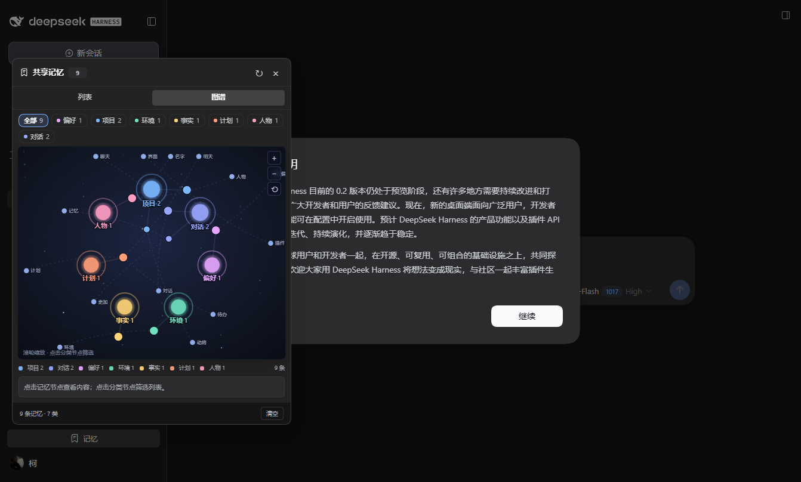
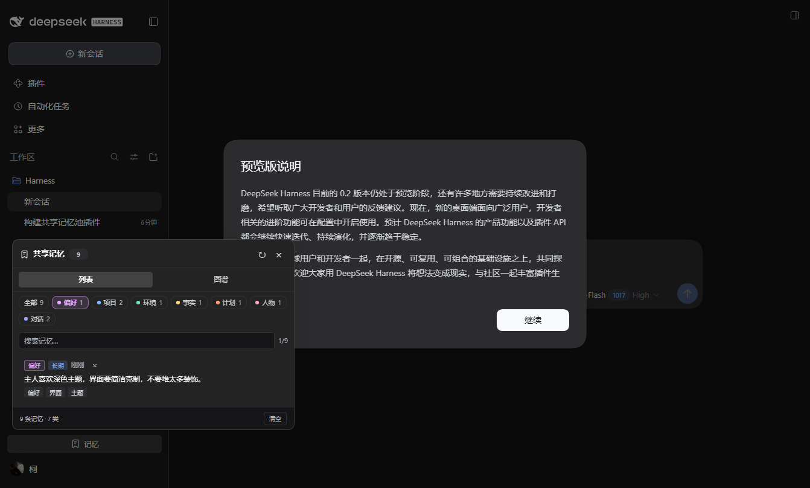

# dsh-memory

给本机所有 DeepSeek Harness 对话共用的一个持久记忆池。相关话题被提及时自动召回，侧边栏底部提供可视化面板；记忆的存储与召回都在本地完成。





## 特点

- **一个本机共享池**：所有会话、所有工作区共用 `$DSH_HOME/storages/dsh-memory/memories.json`。
- **零 token 自动记录**：用户真正输入的 prompt 和助手的最终回复都会在本地写入，不调用模型，不额外消耗 token；插件注入的 runtime context、技能目录、时间快照、工具调用中间步骤不会被误存。
- **克制的自动召回**：用本地 BM25 风格关键词匹配，只有相关度足够高时才注入；最多 2 条、总长不超过 760 字符，只在该轮第一步出现一次，且同一会话不会重复注入同一条记忆。
- **模型可主动维护**：`memory` 工具支持 `search` / `save` / `forget`，适合保存稳定的偏好、环境事实和长期项目约定。
- **自动分类**：每条记忆按标签和本地关键词自动归入 `偏好 / 项目 / 环境 / 事实 / 计划 / 人物 / 对话` 七类，不调用模型，也不额外消耗 token；列表和图谱都可按分类筛选。
- **侧边栏可视化**：侧边栏底部「记忆」按钮打开面板，含列表、图谱两个页签。图谱以分类为星团中心、标签为外圈枢纽，展示记忆之间的关系；支持滚轮缩放、节点悬停、分类筛选和记忆详情。记录是默认行为，面板里没有“添加”按钮。
- **纯本地**：不使用嵌入 API，不联网，不上传任何内容。

## 安装

把仓库克隆到本机后，在仓库根目录运行：

```powershell
git clone https://github.com/Alive-kenan/dsh-memory.git
cd dsh-memory
node scripts/install.mjs desktop
```

安装脚本会把插件复制为 `<DSH_HOME>/profiles/desktop/node_modules/dsh-memory` 真实目录，并把 `dsh-memory` 追加到该 profile 的 `dsh.profile.bundles`；完成后重启 DeepSeek Harness 即可。

> 注意：不要用 `link:` 或目录联接安装。DSH 的 ESM 拦截只对 profile 内的真实路径生效，符号链接会导致启动时报 `ERR_MODULE_NOT_FOUND: @deepseek-ai/dsh-llm`。

## 使用

- 侧边栏底部点击「记忆」打开面板。
- 顶部分类胶囊按 `偏好 / 项目 / 环境 / 事实 / 计划 / 人物 / 对话` 筛选；搜索框同时匹配正文、标签和分类名。
- 「列表」查看、搜索、删除记忆；「图谱」以分类星团和标签枢纽展示关联。点击分类节点/图例筛选，点击记忆节点查看详情，滚轮或右上角 `+ / − / ⟲` 缩放。对话内容默认自动进入池子，不需要手动添加。
- 也可以直接对模型说“记住……”；模型会调用 `memory` 工具保存。
- 删除单条记忆：面板中点击该条右侧的 `×`；清空全部：面板右下角「清空」。

## 数据结构

```json
{
  "version": 1,
  "updatedAt": "2026-11-04T...",
  "memories": [
    {
      "id": "a0d80e9b",
      "text": "用户偏好深色主题……",
      "tags": ["偏好", "界面"],
      "kind": "note",
      "category": "preference",
      "importance": 0.85,
      "hash": "…",
      "createdAt": "…",
      "updatedAt": "…",
      "source": { "sessionId": "…", "cwd": "…" },
      "hits": 0,
      "lastHitAt": null
    }
  ]
}
```

- `kind: "note"` 是模型保存的长期记忆；`kind: "dialogue"` 是本地自动记录的用户 prompt 或助手最终回复。
- `category` 是本地规则算出的分类；旧数据在加载时自动补分类。
- 上限 2500 条，超出时按重要度、时效和类型淘汰。

## 开发

```powershell
node --check lib/index.js
node --check lib/client.js
node scripts/install.mjs desktop
```

Host 半在 `lib/index.js`，客户端半在 `lib/client.js`（手写的 `__ModuleLoader__` bundle，无需打包）。接口为同源 `POST /dsh-memory/api/{list|add|delete|clear}`。

## 已知边界

- 自动召回按关键词匹配，不做语义向量检索；同义改写可能召回不到。
- 自动记录保存用户输入和助手的最终回复，跳过带工具调用的中间步骤；助手回复在产生时就会入库。
- 记忆为明文 JSON，适合本机个人使用，不适合多用户共享主机。
